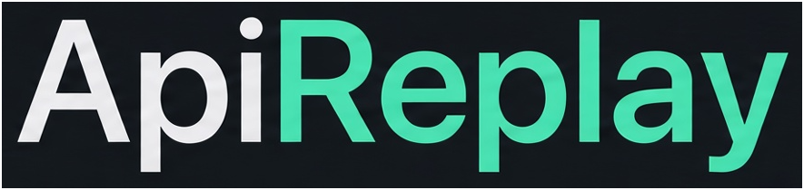

# ApiReplay



Local desktop app for recording API traffic from an embedded Chromium browser, saving selected APIs, and replaying mock responses. No cloud backend, browser extension, proxy, or custom certificates.

Captures stay in memory until you click **Save this API**.

## Docs

- [User guide](docs/user-guide.md) — window, filters, save, mock rules
- [Demo walkthrough](docs/demo.md) — playground recording and mocking
- [Architecture](docs/architecture.md) — CDP, persistence, interceptor

## Requirements

- Node.js 22+
- pnpm 10+

## Setup

```bash
pnpm install
pnpm playground   # http://127.0.0.1:4020
pnpm dev
```

In the app, open `http://127.0.0.1:4020`. The inspector **type filter defaults to XHR**; use the playground XHR buttons first, or set type to Fetch / All types.

Production build:

```bash
pnpm build
pnpm preview
```

Tests:

```bash
pnpm test
pnpm test:e2e
```

`pnpm test` is the automated gate: identity, matching, persistence, fixture APIs, and interceptor behavior (including “never forward after a selected mock fails”). Playwright Electron e2e drives the real desktop shell. Playwright always starts Electron with `--remote-debugging-port`, which can prevent `webContents.debugger.attach()` on some machines. Use `pnpm dev` for the full CDP recording/mocking workflow when that happens.

Slimmer test page (same APIs, less UI):

```bash
pnpm fixture
```

Listens on `http://127.0.0.1:4010`.

## Capture identity

Duplicate APIs are grouped by:

`METHOD + origin + pathname + normalized query`

Query normalization sorts parameter names and values. Different HTTP methods stay distinct.

## Mocking

- Default mode is **mock response** (`Fetch.fulfillRequest`) for `XHR` and `Fetch` requests.
- **Modify and forward** requires an explicit mode change and a confirmation on non-local origins.
- If a selected mock cannot be fulfilled, ApiReplay returns a visible 502 mock-failure response. It never forwards that request to the real backend.
- **Disable** continues any paused requests and turns Fetch interception off.

## CDP limitations

ApiReplay uses Electron `webContents.debugger` (Chrome DevTools Protocol 1.3).

- WebSockets, SSE, and other streams are not mocked via `fulfillRequest`.
- Service-worker and disk-cache responses may have unavailable bodies.
- `Network.getResponseBody` can fail; bodies are labeled `available`, `empty`, `unavailable`, `too-large`, or `unsupported` and are never silently truncated.
- Document, media, download, and websocket resource types are not Fetch-intercepted.
- Redirects, HTTP/3, and opaque responses may omit details that a full DevTools Network panel would show.
- Network `requestId` and Fetch `requestId` are not assumed to be the same. Correlation uses `networkId` when CDP provides it.

## Privacy

All processing stays on the local machine. Authorization headers and cookies are redacted from ordinary logs. Unsaved traffic is never written to SQLite (SQL.js). Saved APIs and mock rules persist in a local SQLite file under the app user data directory.
