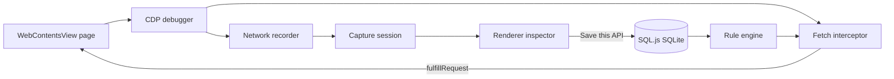

# Architecture

## Processes

- **Main:** Electron window, `WebContentsView`, CDP attach, capture session, interceptor, SQL.js.
- **Preload:** Isolated `window.apireplay` IPC.
- **Renderer:** React inspector (Jotai, TanStack Query, Tailwind). It does not see the page DOM; the page is a sibling `WebContentsView`.

## Recording

While recording, `Network.*` events are correlated into capture groups. `Network.getResponseBody` is attempted when CDP allows it. Document, media, download, and websocket types are observed when present but are not Fetch-intercepted.

## Mocking

Mocks use CDP **Fetch** at request stage for `XHR` and `Fetch` only, and only when **Mocks on** is enabled and an enabled rule matches. Default mode is `Fetch.fulfillRequest`. Network `requestId` and Fetch `requestId` are correlated via `networkId` when CDP provides it.

## Persistence

Unsaved captures never touch disk. Saved APIs and rules persist through SQL.js (`sql-wasm-inline`) so the same code path runs in Node tests and Electron.

## Limits

See the README **CDP limitations** section. Streams (WebSocket, SSE) are not mocked via `fulfillRequest`. Playwright e2e can fail to attach the debugger because Playwright starts Electron with `--remote-debugging-port`.
